# Ubuntu Command Line: File Management, User Administration, and Permissions

**Environment:** Ubuntu VM (`tameshia-Virtual-Machine`) | **Course:** IT120 A+ Core 2 | **Focus:** Bash, Linux accounts, file permissions

[← Back to IT Systems Administration Labs](../README.md)

## Overview

Completed a hands-on Ubuntu terminal lab covering directory navigation, file creation and redirection, file operations, network-interface inspection, account management, and permission changes. Extended the assigned work with verification commands, deliberate permission-error testing, ownership inspection, and cleanup of an orphaned home directory.

**Evidence:** Commands and outputs below are based on the completed terminal session. The 22 screenshots are stored in [screenshots/](screenshots/) and embedded alongside the relevant steps below.

## Objectives

- Navigate the Linux filesystem using absolute and relative paths.
- Create, inspect, rename, copy, and remove files.
- Inspect IP addressing and interface state.
- Create and validate a standard user account and associated group.
- Explain ownership, directory traversal, and `chmod` permissions.
- Verify account deletion and clean up residual files.

## 1. Command Line Basics

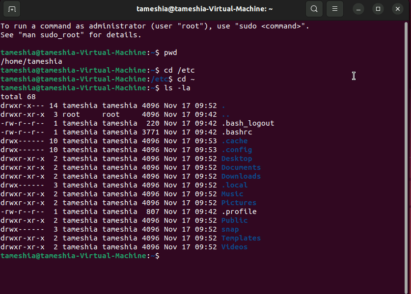

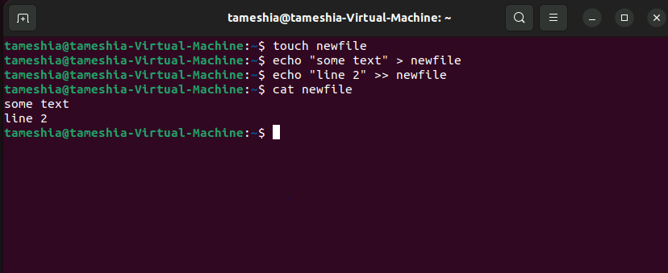

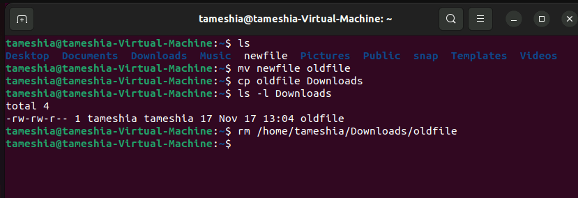

| Command | Observed result |
|---|---|
| `pwd` | `/home/tameshia` |
| `cd /etc` | Prompt changed to `/etc` |
| `cd ~` | Returned to home directory |
| `ls -la` | Listed home contents, including hidden configuration files |
| `touch newfile` | Created a file |
| `echo "some text" > newfile` | Wrote the first line |
| `echo "line 2" >> newfile` | Appended the second line |
| `cat newfile` | Displayed both lines |
| `mv newfile oldfile` | Renamed the file |
| `cp oldfile Downloads` | Copied it to Downloads |
| `ls -l Downloads` | Verified `oldfile`, 17 bytes |
| `rm /home/tameshia/Downloads/oldfile` | Removed the Downloads copy |
| `ip a` | Displayed loopback and Ethernet interface information |

**Verified text output:**

```text
$ cat newfile
some text
line 2
```

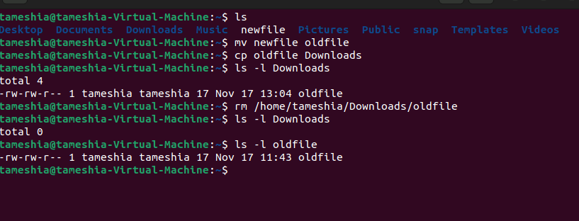

**Additional deletion verification:** `ls -l Downloads` returned `total 0`; `ls -l oldfile` confirmed the original 17-byte file still existed in the home directory.

**Redirection:** `>` overwrites the destination file; `>>` appends without discarding its existing contents.

### Network observations

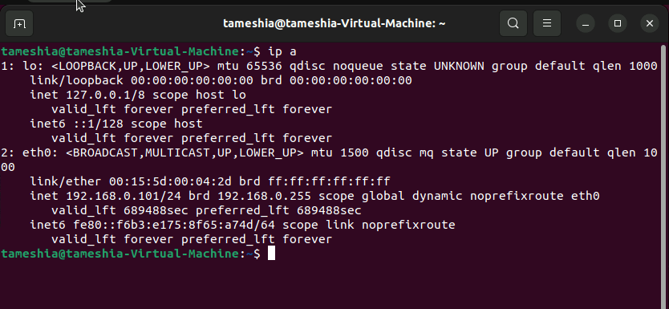

`ip a` displayed:

- `lo`: `127.0.0.1/8` and `::1/128` (loopback).
- `eth0`: `192.168.0.101/24`, broadcast `192.168.0.255`, MAC `00:15:5d:00:04:2d`; interface state `UP`.

The `UP` state alone does **not** verify internet connectivity.

## 2. Managing Users

Created the temporary user:

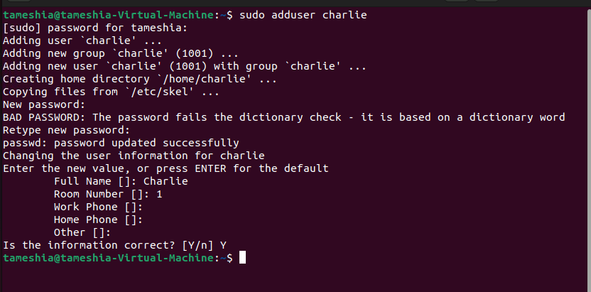

```bash
sudo adduser charlie
```

Ubuntu reported a new user and primary group, both numbered `1001`, and created `/home/charlie` using templates from `/etc/skel`. The password-quality check displayed a dictionary warning, but the password update succeeded. No password is recorded here.

### Account verification

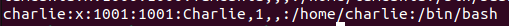

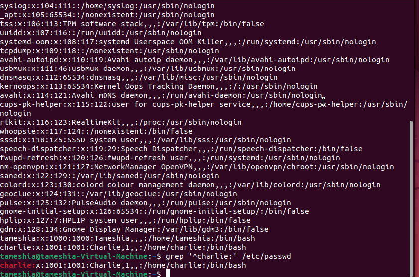

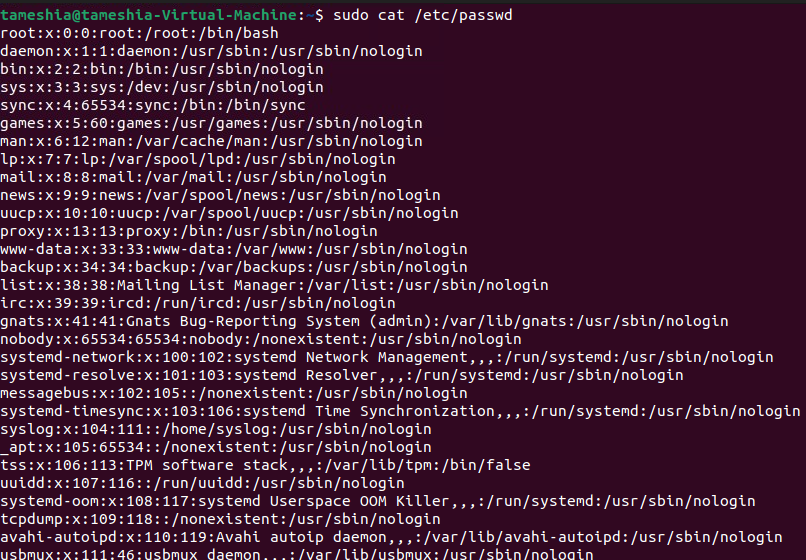

```bash
sudo cat /etc/passwd
grep '^charlie:' /etc/passwd
sudo grep sudo /etc/group
grep '^charlie:' /etc/group
sudo grep -q '^charlie:' /etc/shadow && echo "Charlie's shadow entry exists"
```

Verified results:

```text
charlie:x:1001:1001:Charlie,1,,,:/home/charlie:/bin/bash
sudo:x:27:tameshia
charlie:x:1001:
Charlie's shadow entry exists
```

- `/etc/passwd` records account metadata, including UID, primary GID, home, and shell.
- `/etc/group` records groups and supplementary member lists.
- `/etc/shadow` stores restricted password-hash and aging information. The quiet `grep` check verified an entry **without printing the hash**.
- The `sudo` group output listed `tameshia`, not `charlie`; actual sudo access depends on configured sudo policy.

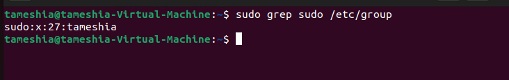

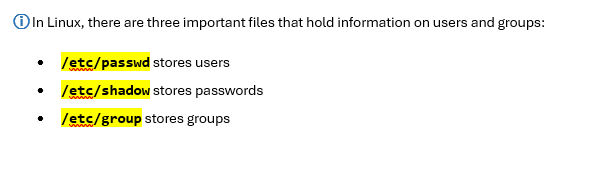

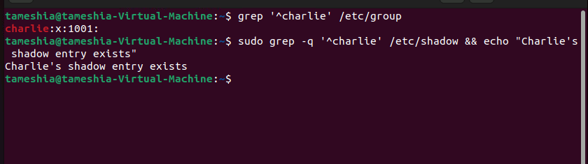

Switched identities and verified the new session:

```text
$ su - charlie
$ whoami
charlie
$ pwd
/home/charlie
```

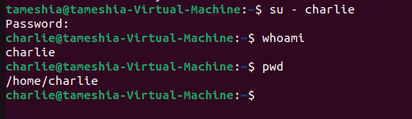

## 3. File Permissions and Troubleshooting

As `charlie`, created and inspected an empty file:

```bash
touch permissions
ls -l permissions
```

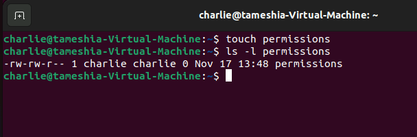

Initial output:

```text
-rw-rw-r-- 1 charlie charlie 0 Nov 17 13:48 permissions
```

The permission string divides into **file type | owner | group | others**: `- | rw- | rw- | r--`.

### Experiment A — Copy blocked by parent directory

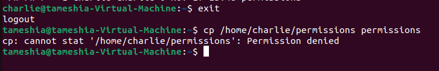

After `exit` returned to `tameshia`:

```text
$ cp /home/charlie/permissions permissions
cp: cannot stat '/home/charlie/permissions': Permission denied
```

Directory inspection showed:

```text
drwxr-x--- 2 charlie charlie 4096 Nov 17 13:52 /home/charlie
```

Although the file permitted read access to others, `/home/charlie` did **not** permit others to traverse the directory (`x`), preventing access to the file by pathname.

### Experiment B — Deliberate wrong-user chmod attempt

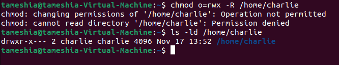

As `tameshia`, deliberately ran:

```bash
chmod o=rwx -R /home/charlie
```

Observed:

```text
chmod: changing permissions of '/home/charlie': Operation not permitted
chmod: cannot read directory '/home/charlie': Permission denied
```

**Lesson:** A normal user generally cannot change permissions on another user's files. Ownership and access permissions are related but distinct controls.

### Experiment C — Owner changes permissions and copy succeeds

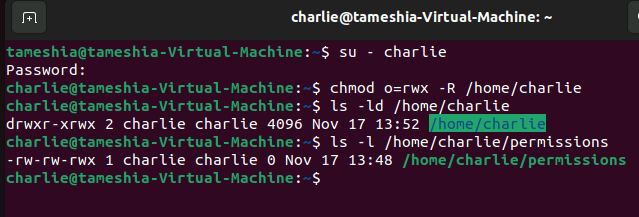

Switched back to `charlie` and ran the assigned command:

```bash
su - charlie
chmod o=rwx -R /home/charlie
ls -ld /home/charlie
ls -l /home/charlie/permissions
```

Verified:

```text
drwxr-xrwx 2 charlie charlie 4096 Nov 17 13:52 /home/charlie
-rw-rw-rwx 1 charlie charlie 0 Nov 17 13:48 /home/charlie/permissions
```

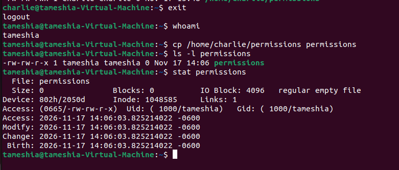

After returning to `tameshia`, the original `cp /home/charlie/permissions permissions` command succeeded. `ls -l` and `stat permissions` verified the new file was owned by UID/GID `1000` (`tameshia`), with mode `0665` (`-rw-rw-r-x`), and size 0 bytes. Charlie still owned the source file at that point.

> **Security warning:** `chmod o=rwx -R /home/charlie` grants other local users broad access, including write access, and should **not** be used on real user home directories. It was performed solely to demonstrate permissions in the training VM.

### Restore and remove the temporary account

Restored the directory's other-user restrictions:

```bash
sudo chmod -R o-rwx /home/charlie
ls -ld /home/charlie
```

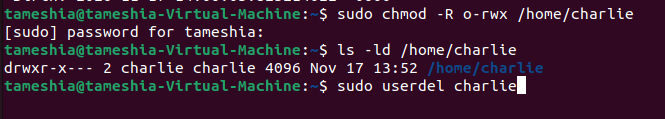

The directory returned to `drwxr-x---`. Then deleted the account using the worksheet's `sudo userdel charlie`.

Verification:

```text
$ id charlie
id: ‘charlie’: no such user
$ ls -ld /home/charlie
drwxr-x--- 2 1001 1001 4096 Nov 17 13:52 /home/charlie
```

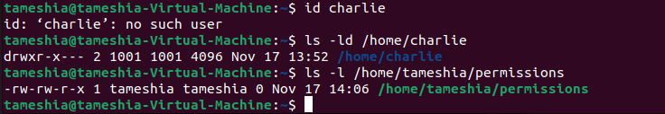

The directory survived account deletion, and its owner/group displayed as numeric IDs because the names no longer resolved. The user's copied file remained in `/home/tameshia`.

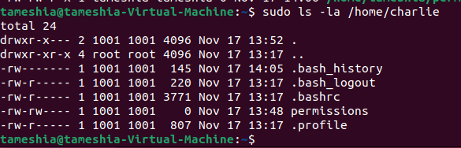

Inspected residual files with `sudo ls -la /home/charlie`: `.bash_history`, `.bash_logout`, `.bashrc`, `.profile`, and the empty `permissions` file. The presence of `.bash_history` was verified; **its contents were not inspected**.

Finally, after checking the target, removed the leftover practice directory with confirmation:

```bash
sudo rm -rI /home/charlie
ls -ld /home/charlie
```

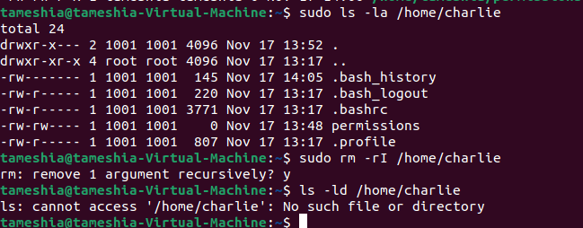

The final `ls` returned `No such file or directory`, confirming cleanup. Recursive removal is destructive and must be used only after validating the target.

## Conceptual analogy: Apartment access

- **Home directory:** An apartment with an entry door.
- **File:** A document inside the apartment.
- **File read permission:** Permission to read the document.
- **Directory execute permission:** Permission to pass through the apartment entrance to reach a known item.
- **File owner:** The person who controls ordinary permission changes on the document.
- **`sudo`:** A separately authorized administrative key for a particular task.

A document can be readable to everyone while still inaccessible because the parent directory blocks traversal.

## Security and Administration Takeaways

1. Verify changes using independent commands (`ls`, `stat`, `whoami`, `id`).
2. Use least privilege; reserve `sudo` for tasks requiring elevated authorization.
3. Evaluate directory traversal **and** file permissions when diagnosing `Permission denied`.
4. Be cautious with recursive permission changes and recursive deletion.
5. Removing a user with `userdel` does not necessarily remove owned files or the home directory.
6. Numeric ownership may persist after user deletion; account offboarding should review residual files and UID reuse risk.

## Knowledge Check

<details>
<summary>1. How do <code>&gt;</code> and <code>&gt;&gt;</code> differ?</summary>

`>` overwrites a destination file; `>>` appends to it.
</details>

<details>
<summary>2. Why did copying Charlie's readable file initially fail?</summary>

The parent directory did not grant other users execute/traverse permission.
</details>

<details>
<summary>3. Why did chmod fail when run as tameshia?</summary>

Tameshia was not the owner of Charlie's home directory and did not elevate the command.
</details>

<details>
<summary>4. What does the <code>-R</code> option do in chmod?</summary>

It recursively applies the requested change to the specified directory and its contents.
</details>

<details>
<summary>5. What do the three permission triplets represent?</summary>

Permissions for owner, owning group, and others, in that order.
</details>

<details>
<summary>6. Why did Charlie's former home directory display 1001:1001 after account deletion?</summary>

The filesystem retained numeric UID/GID ownership while the corresponding account and group names no longer resolved.
</details>

<details>
<summary>7. Did deleting Charlie remove Tameshia's copied file?</summary>

No. The copy was a separate file owned by Tameshia.
</details>

<details>
<summary>8. What does <code>grep -q ... &amp;&amp; echo ...</code> demonstrate?</summary>

Quiet searching and conditional execution: the echo runs only if grep succeeds.
</details>

## References

- [GNU Coreutils Manual — File utilities](https://www.gnu.org/software/coreutils/manual/html_node/index.html)
- [GNU Bash Manual — Redirections](https://www.gnu.org/software/bash/manual/html_node/Redirections.html)
- [Ubuntu Server documentation — User management](https://documentation.ubuntu.com/server/how-to/security/user-management/)
- [Linux man-pages — chmod(1)](https://man7.org/linux/man-pages/man1/chmod.1.html)
- [Linux man-pages — passwd(5)](https://man7.org/linux/man-pages/man5/passwd.5.html)
- [Linux man-pages — shadow(5)](https://man7.org/linux/man-pages/man5/shadow.5.html)
- [Linux man-pages — group(5)](https://man7.org/linux/man-pages/man5/group.5.html)

---

[← Back to IT Systems Administration Labs](../README.md)
