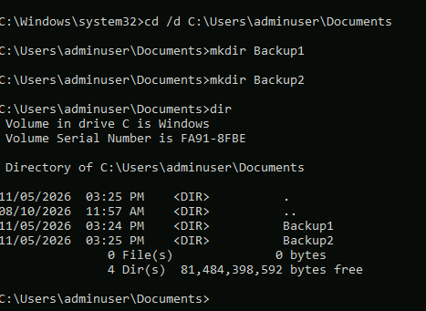
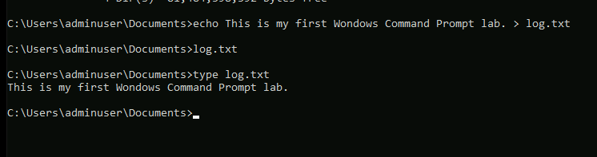
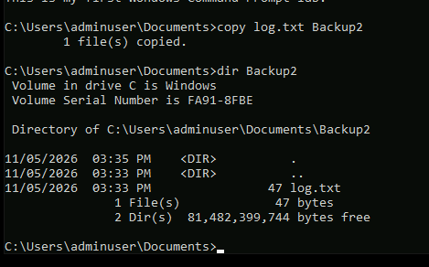
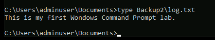
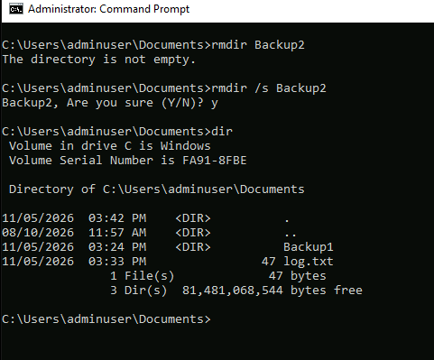
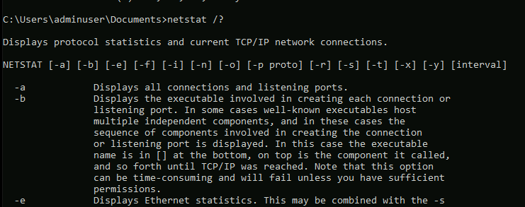
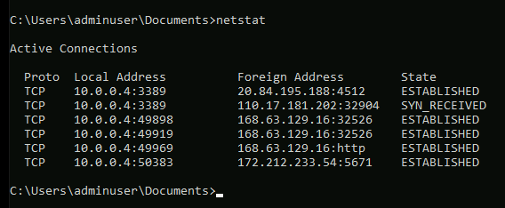
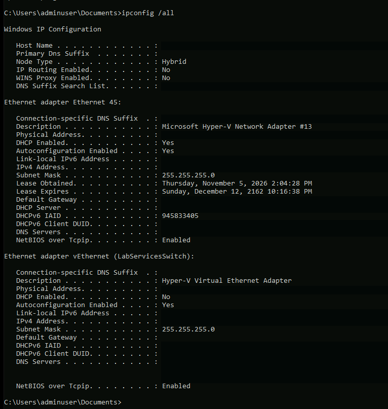
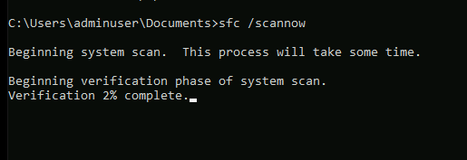

# Windows Command Prompt: File Management, Networking, and System Diagnostics

## Project Overview

In this hands-on lab, I used Windows Command Prompt to manage files and directories, investigate network activity, review network adapter settings, and initiate a system file integrity scan. I also practiced troubleshooting an unsuccessful command and verifying the results of file operations.

The work was completed in a Windows virtual machine as part of my IT120 A+ Core 2 coursework. The exercise required using Command Prompt rather than File Explorer.

## Lab Environment and Tools

- **Environment:** Windows virtual machine
- **Interface:** Command Prompt (`cmd.exe`)
- **File management:** `cd`, `mkdir`, `dir`, `echo`, `type`, `copy`, `rmdir`
- **Network diagnostics:** `netstat`, `ipconfig`
- **System diagnostics:** `sfc`
- **Other concepts:** Administrator privileges, output redirection, command help, and command chaining

## Objectives

1. Navigate the Windows file system and manage files and folders.
2. Create text files and verify file-copy operations.
3. Diagnose and resolve a directory-removal error.
4. Inspect active network connections and adapter configuration.
5. Initiate a Windows system file integrity scan.
6. Review Windows file-copy commands and command chaining.

## Procedure and Observations

### 1. Navigate to Documents and Create Folders

I opened Command Prompt, navigated to my Documents directory, and created two folders: `Backup1` and `Backup2`.

```cmd
cd /d C:\Users\adminuser\Documents
mkdir Backup1
mkdir Backup2
dir
```

The `dir` output verified that both directories were created.



*Created two folders and verified their existence using `dir`.*

**Concept:** An elevated Command Prompt runs with administrator privileges. These privileges are needed for some administrative tasks, but not for every file-management command.

### 2. Create and Read a Log File

I created a text file named `log.txt` by redirecting the output of `echo` into the file. I then used `type` to display its contents.

```cmd
echo This is my first Windows Command Prompt lab. > log.txt
type log.txt
```



*Used `echo` and `>` to write a file, then `type` to confirm its contents.*

**Concept:** The `>` operator redirects output to a file. If the target file already exists, this form of redirection replaces its contents.

### 3. Copy the Log File and Verify the Copy

I copied `log.txt` into `Backup2`:

```cmd
copy log.txt Backup2
dir Backup2
```

Command Prompt reported that one file was copied, and the directory listing showed `log.txt` inside `Backup2`.



*Copied the log file into `Backup2` and checked the folder listing.*

I also opened the copied file's contents from Command Prompt:

```cmd
type Backup2\log.txt
```



*Verified that the copied file contained the expected text.*

**Observation:** Checking both the file listing and its contents provides stronger confirmation than relying on the copy command's success message alone.

### 4. Troubleshoot and Remove a Nonempty Directory

I initially attempted to remove the `Backup2` directory with:

```cmd
rmdir Backup2
```

Windows responded:

```text
The directory is not empty.
```

Because the directory contained `log.txt`, I used the `/s` option and confirmed the prompt:

```cmd
rmdir /s Backup2
dir
```



*The first removal failed because the folder contained a file. Using `rmdir /s` removed the folder and its contents, and `dir` confirmed the result.*

**Troubleshooting lesson:** `rmdir` removes an empty directory; `rmdir /s` removes a directory tree. The latter is destructive, so verifying the path before using it is important.

### 5. Display Netstat Help and Review Active Connections

I displayed the available options for `netstat`:

```cmd
netstat /?
```



*Reviewed command usage and available switches for `netstat`.*

Next, I ran:

```cmd
netstat
```

The results included TCP connections in states such as `ESTABLISHED` and `SYN_RECEIVED`.



*Inspected network connections and their current TCP states.*

**Observation:** The number of connections can change depending on system activity. If few or none appear, the computer may not be communicating actively at that moment.

### 6. Inspect Detailed Network Configuration

I ran:

```cmd
ipconfig /all
```

The output displayed network adapter information, including IP addresses, subnet masks, default gateways, DNS servers, DHCP settings, and a virtual network adapter associated with Hyper-V.



*Reviewed adapter configuration with `ipconfig /all`. Identifying information in this screenshot was redacted before publication.*

**Why this matters:** `ipconfig /all` can help troubleshoot network configuration and connectivity problems by showing the settings assigned to each adapter.

### 7. Initiate a System File Checker Scan

I ran:

```cmd
sfc /scannow
```

The command started a system scan and entered its verification phase.



*Initiated a System File Checker scan to check Windows protected system files.*

**Important distinction:** The assignment allowed the scan to be interrupted with Ctrl+C. My screenshot documents the scan starting, not a completed repair or scan result.

### 8. Optional Challenges

**Compare Windows file-copy commands**

| Command | Primary purpose |
| --- | --- |
| `COPY` | Copies files |
| `XCOPY` | Copies files and directory structures |
| `ROBOCOPY` | Supports advanced directory copying, including retry behavior and options to preserve metadata |

**Chain multiple commands**

I wrote a one-line command to navigate to Documents, create a directory named `Challenge`, write `log.txt` inside it, and display the new directory contents:

```cmd
cd /d "%USERPROFILE%\Documents" && mkdir Challenge && echo Challenge completed > Challenge\log.txt && dir Challenge
```

The `&&` operator runs the next command only if the preceding command succeeds.

*This optional challenge was included as a written answer in my lab submission; I did not include a screenshot showing the command executing.*

## Skills Demonstrated

- Navigating directories through the Windows command line
- Creating files and folders without File Explorer
- Using output redirection and reading text files
- Copying files and verifying their contents
- Interpreting and resolving command errors
- Inspecting TCP connections using `netstat`
- Reviewing network adapter configuration using `ipconfig /all`
- Initiating a system file integrity check
- Using command help and understanding command chaining

## Lessons Learned

This lab helped me become more comfortable administering Windows from the command line. In particular, I learned the importance of **verifying each result**, whether by listing a directory, reading a copied file, or checking that a folder was deleted.

The unsuccessful `rmdir` command was a useful troubleshooting example: the error message identified why the operation failed, and I adjusted the command to match the situation. I also gained experience using built-in Windows utilities to inspect network connections and system configuration.

---

[← Back to IT Systems Administration Labs](../README.md)

*Documented from a completed Windows Command Prompt lab for IT120 A+ Core 2. Screenshots show the commands and observations recorded during the exercise.*