# Windows DiskPart Management: GPT Partitioning and NTFS Formatting

## Project Overview

In this lab, I used **DiskPart in a Windows 11 training VM** to prepare a disposable virtual disk, create an NTFS volume, assign a drive letter, and verify the resulting storage configuration. I also investigated a mismatch between the assignment's expected disks and the VM I initially opened.

**Tools:** Elevated Command Prompt, DiskPart, Disk Management, Hyper-V Manager  
**Environment:** School-provided Spektra environment; Hyper-V guest **ws1w11**  
**Topics:** Disk selection, GPT, primary partitions, NTFS, volume verification, storage troubleshooting

> **Lab-only warning:** `clean` and formatting operations destroy access to existing data. Disk numbers are environment-specific. Verify the VM, disk identity, size, and role before changing a disposable lab disk. Do not copy `select disk 4` onto another computer without checking its storage configuration.

### Learning objectives

1. Identify the correct VM and target disk before destructive operations.
2. Establish GPT partitioning and create a primary partition.
3. Format with NTFS and assign a drive letter.
4. Validate disk, partition, and volume properties.
5. Distinguish unallocated disk space from free space within a volume.

### Confirmed outcome

| Component | Verified result |
| --- | --- |
| Target | Disk 4, Microsoft Virtual Disk, 100 MB |
| Partitioning scheme | GPT |
| Partition | Partition 1, Primary, 99 MB, 64 KB offset |
| Volume | Volume 4, E:, NTFS, Healthy |
| Final disk state | Online; 0 B unallocated reported |
| Final volume space | 99 MB capacity; 85 MB free |

Sizes are rounded values displayed by DiskPart. **Ten configuration screenshots and three troubleshooting screenshots** are included. Command excerpts below transcribe visible results; they are not a reconstructed full console transcript. Educational comparisons and hypothetical examples are labeled separately. No `exit` screenshot was available, so execution of that final assignment command is **not independently verified**.

## Storage Fundamentals — Apartment-Building Analogy

This is a teaching analogy for this simple basic-disk lab, not a literal description of every Windows storage arrangement.

| Storage term | Apartment-building analogy | Technical meaning |
| --- | --- | --- |
| Disk | Entire building | Physical or virtual storage device presented to Windows |
| GPT | Building's layout plan and directory | Partitioning scheme recording partition locations and types |
| Partition | An individual apartment | A defined region of a disk |
| Volume | The apartment's usable storage space | A logical storage unit Windows manages; here it corresponds to the primary data partition |
| NTFS | The apartment's system for organizing belongings and access | File system organizing files, directories, metadata, and permissions |
| Drive letter | The apartment's address | A Windows access path such as E: |

A partition and a volume are closely related here, but the terms are not universally interchangeable: more complex storage can map volumes differently. A drive letter is also not the only access method; Windows supports mounted folder paths.

**In this lab:** Disk 4 → GPT partition layout → Partition 1 → NTFS Volume 4 → E:. Disk, partition, and volume numbers identify different objects and do not have to match.

## Part 1 — Verify the Environment and Target

### Step 1. Start DiskPart and list disks

I opened **Command Prompt as Administrator** in `ws1w11` and entered:

```cmd
diskpart
list disk
```

**Observed:** Disk 0 was 80 GB and already GPT. Disks 1–4 were each 100 MB with 100 MB free in the listing. Disk 4 was the assignment target.

`list disk` lists physical and virtual disks recognized by Windows; it does not list the partitions inside each disk.

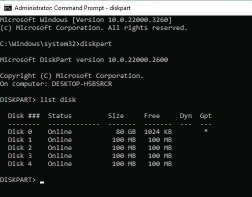

### Step 2. Select and inspect Disk 4

```text
DISKPART> select disk 4
Disk 4 is now the selected disk.

DISKPART> detail disk
```

**Observed:** Microsoft Virtual Disk, Type SAS, Online, not read-only, Boot Disk No, Pagefile Disk No, and no volumes. The previous listing established the target's 100 MB size.

Selection changes DiskPart's **focus** for subsequent operations. It does not attach a missing disk or create a new one. I checked identity and role before proceeding.

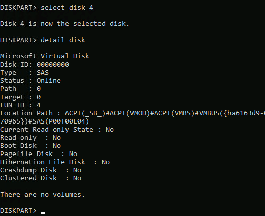

## Part 2 — Prepare and Format the Disk

### Step 3. Remove existing partition information

```text
DISKPART> clean
DiskPart succeeded in cleaning the disk.
```

**Confirmed:** `clean` succeeded on the selected lab disk. It removes partition/volume formatting information; it is not a full-disk overwrite. See the reference comparison below.

### Step 4. Choose GPT

```text
DISKPART> convert gpt
DiskPart successfully converted the selected disk to GPT format.
```

GPT defines the partition layout. It does not itself create an NTFS file system. This lab explicitly selected GPT before creating the data partition.

### Step 5. Create a primary partition

```text
DISKPART> create partition primary
DiskPart succeeded in creating the specified partition.
```

No size was supplied; the command used the available space. Creation alone does not format the partition.

### Step 6. Verify the partition

```text
DISKPART> list partition

  Partition ###  Type              Size     Offset
  -------------  ----------------  -------  -------
* Partition 1    Primary             99 MB    64 KB
```

**Confirmed:** Partition 1 was selected, Primary, and displayed as 99 MB. The offset was 64 KB. These are observed lab values, not recommended universal partition sizes or alignment settings.

| Clean | GPT conversion |
| --- | --- |
| [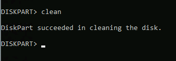](screenshots/03-clean.webp) | [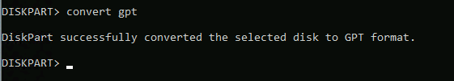](screenshots/04-convert-gpt.webp) |
| **Create partition** | **Verify partition** |
| [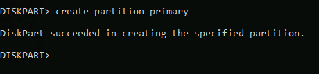](screenshots/05-create-partition.webp) | [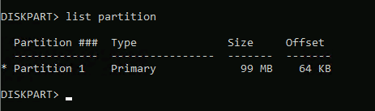](screenshots/06-list-partition.webp) |

### Step 7. Format with NTFS

```text
DISKPART> format fs=ntfs quick

  100 percent completed

DiskPart successfully formatted the volume.
```

`fs=ntfs` specifies the file system; `quick` requests a quick format. NTFS supplies file and directory organization, metadata, permissions, and file-system journaling. Quick formatting is not secure erasure.

### Step 8. Assign a drive letter

```text
DISKPART> assign
DiskPart successfully assigned the drive letter or mount point.
```

The success message alone does not specify a letter. **The later `detail partition` screenshot confirms E:.** I did not explicitly request `letter=E`.

| NTFS formatting | Drive-letter assignment |
| --- | --- |
| [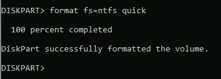](screenshots/07-format-ntfs.webp) | [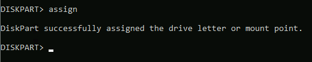](screenshots/08-assign-letter.webp) |

## Part 3 — Validate the Result

### Step 9. Inspect the partition and associated volume

```cmd
detail partition
```

| Property | Observed value |
| --- | --- |
| Partition | 1 |
| Type GUID | `ebd0a0a2-b9e5-4433-87c0-68b6b72699c7` |
| Hidden / Required | No / No |
| Offset in bytes | 65536 |
| Associated volume | Volume 4 |
| Letter / File system | E: / NTFS |
| Size / Status | 99 MB / Healthy |

The type GUID identifies the **Microsoft Basic Data partition type**, not a unique identifier for this individual partition.

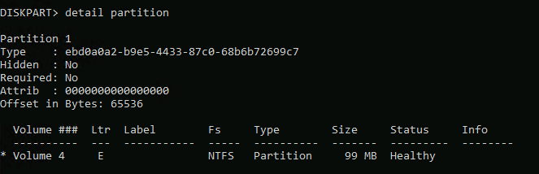

### Step 10. Inspect volume details

```cmd
detail volume
```

**Observed:** The disk row showed Disk 4, Online, 100 MB, 0 B free, with an asterisk under GPT. The volume was not read-only, hidden, offline, or BitLocker encrypted. Capacity was 99 MB and volume free space was 85 MB.

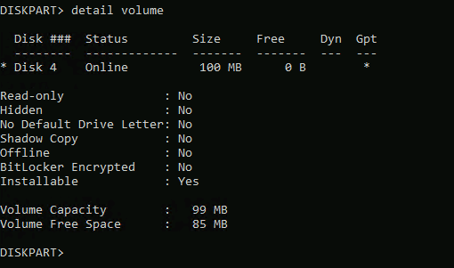

**Reference note:** `detail volume` requires volume focus. If no volume is selected in another session, identify and select the correct volume first. An extra `select volume 4` command is **not documented as executed** in these screenshots.

### Final assignment command — evidence limit

`exit` would leave DiskPart and return to Command Prompt without undoing the changes. It appears in the assignment, but there is **no verified screenshot or console output showing it was executed**. The configuration and verification results above are documented independently of that missing evidence.

## Study Note — Disk Free Space vs. Volume Free Space

| Measurement | Lab value | Meaning |
| --- | --- | --- |
| Disk-level Free | 0 B | No unallocated space reported for additional partitions |
| Volume Capacity | 99 MB | Total space within the formatted volume |
| Volume Free Space | 85 MB | Unused file-system space available for files |

**A disk can be fully partitioned without being full of files.** In the apartment analogy, all building space can be assigned to apartments while there is still room inside an apartment for belongings.

**Illustrative example, not a performed test:** An ordinary 90 MB file would not fit in 85 MB of available volume space under normal conditions. The volume would need more free space, or the file would need another destination. Disk 4 had no reported unallocated space to extend into. Expanding the underlying virtual disk and then extending the volume would be a separate administrative task; it was **not performed** in this lab.

The difference between the 99 MB capacity and 85 MB free value should not be treated as proof that user files were copied. NTFS itself consumes space for file-system structures.

## Study Note — `clean` vs. `clean all`

| Aspect | `clean` | `clean all` |
| --- | --- | --- |
| Action | Removes partition/volume formatting information | Writes zeros across every sector exposed by the selected disk |
| Typical duration | Usually quick | Depends on disk size and write speed; generally much longer |
| Data-recovery implication | Underlying data may remain recoverable | Overwrites the addressable disk contents |
| Lab status | **Executed; success captured** | **Not executed; reference only** |

Both are destructive. `clean all` is not a guarantee of sanitizing inaccessible, remapped, or underlying virtual-storage copies. Neither this lab nor its screenshots demonstrate secure media sanitization. On GPT disks, Microsoft documents that `clean` overwrites GPT partitioning information, including the protective MBR.

## Troubleshooting — The Wrong VM

### Symptom

My initial `list disk` showed only **Disk 0, 52 GB**. The assignment expected Disk 4. Disk Management confirmed that Disk 0 contained the Windows C: volume, EFI partition, and recovery partition; D: was installation media on a virtual DVD drive.

### Investigation and correction

I checked the Spektra-hosted Hyper-V environment. **ws2w11** was selected and running, while the required **ws1w11** was off. After switching to the assigned VM, `list disk` showed Disk 0 through Disk 4, including the intended 100 MB target.

This established a VM-selection mismatch. The initial missing-disk result did **not** prove that the intended VM needed new virtual hardware. No `clean` operation on the initial system disk is documented.

| Initial disk listing | Disk Management cross-check |
| --- | --- |
| [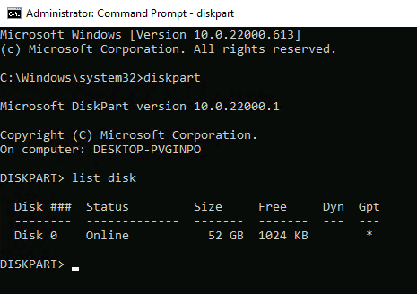](screenshots/11-wrong-vm-list-disk.webp) | [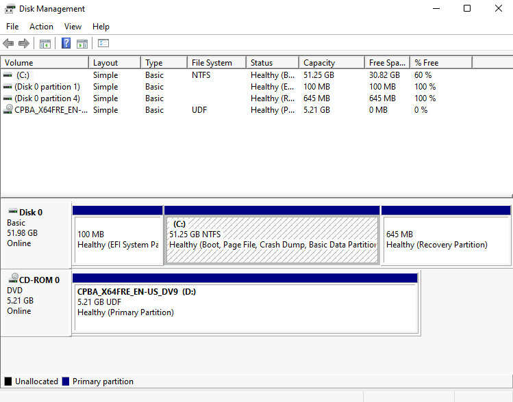](screenshots/12-wrong-vm-disk-management.webp) |

[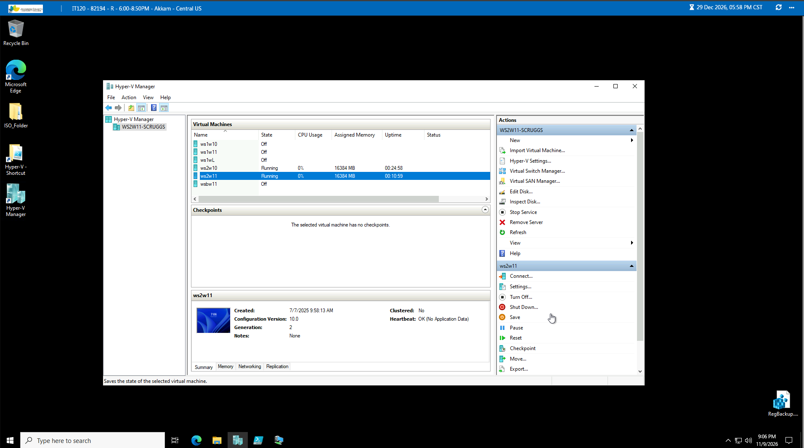](screenshots/13-hyper-v-vm-selection.webp)

**Lesson learned:** Verify the environment → identify the target → execute the change → validate the result. Selecting a disk cannot make an absent disk appear, and a disk number in an assignment is not sufficient evidence of the correct target.

## Screenshot Evidence Index

Select any link to open the image. The first ten images were recovered from the completed assignment; the final three document the earlier troubleshooting. Educational analogy screenshots from the conversation are represented as accessible text above, not counted as lab execution evidence.

| # | Evidence |
| --- | --- |
| 01 | [Correct VM: available disks](screenshots/01-list-disk.webp) |
| 02 | [Select Disk 4 and inspect disk identity](screenshots/02-select-and-detail-disk.webp) |
| 03 | [Clean success](screenshots/03-clean.webp) |
| 04 | [GPT conversion success](screenshots/04-convert-gpt.webp) |
| 05 | [Primary partition creation](screenshots/05-create-partition.webp) |
| 06 | [Partition listing](screenshots/06-list-partition.webp) |
| 07 | [NTFS quick format](screenshots/07-format-ntfs.webp) |
| 08 | [Drive-letter assignment](screenshots/08-assign-letter.webp) |
| 09 | [Partition and E: volume details](screenshots/09-detail-partition.webp) |
| 10 | [Final volume verification](screenshots/10-detail-volume.webp) |
| 11 | [Wrong VM: initial disk listing](screenshots/11-wrong-vm-list-disk.webp) |
| 12 | [Wrong VM: Disk Management](screenshots/12-wrong-vm-disk-management.webp) |
| 13 | [Hyper-V VM selection](screenshots/13-hyper-v-vm-selection.webp) |

## Key Takeaways

- Verify the VM and disk role before any destructive disk operation.
- GPT describes partition layout; NTFS organizes files within the volume.
- Disk selection, partition creation, formatting, and drive-letter assignment are separate actions.
- A success message should be followed by inspection of the resulting state.
- Disk allocation and file-system free space answer different questions.
- Document observed evidence separately from examples, suggested commands, and unverified steps.

## References

These references explain command behavior; the screenshots above are the evidence of my lab results.

- [Microsoft Learn — DiskPart](https://learn.microsoft.com/en-us/windows-server/administration/windows-commands/diskpart)
- [Microsoft Learn — clean](https://learn.microsoft.com/en-us/windows-server/administration/windows-commands/clean)
- [Microsoft Learn — select volume](https://learn.microsoft.com/en-us/windows-server/administration/windows-commands/select-volume)

---

[← Back to IT Systems Administration Labs](../README.md)

