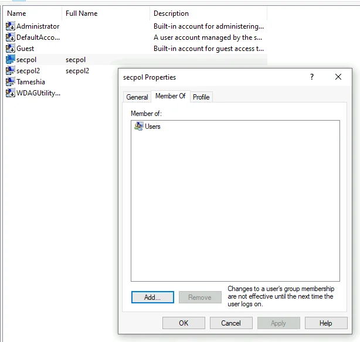
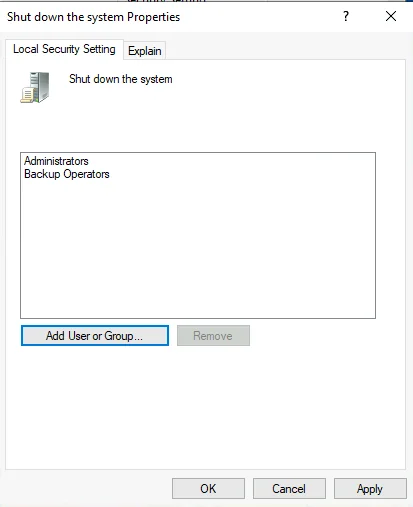
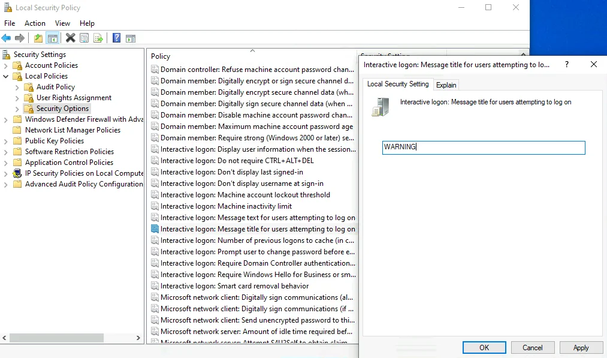
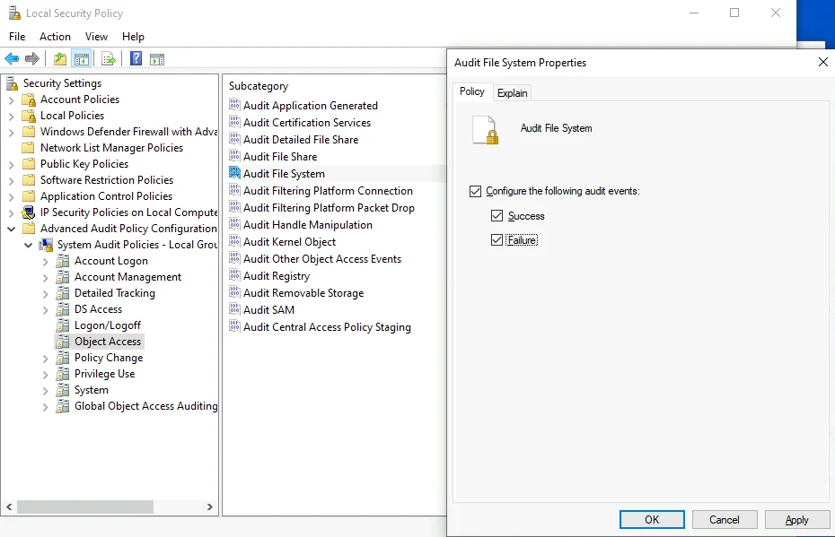
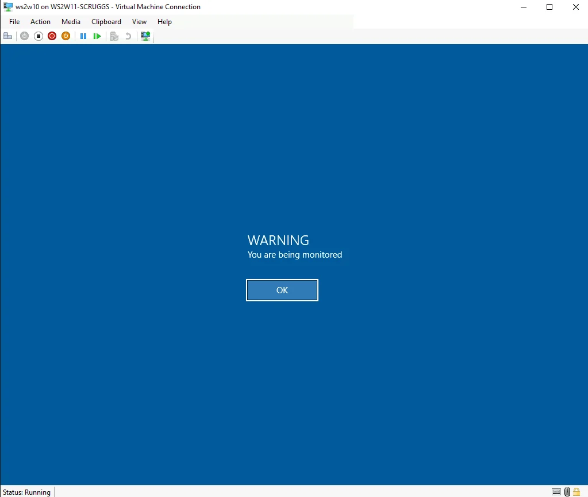
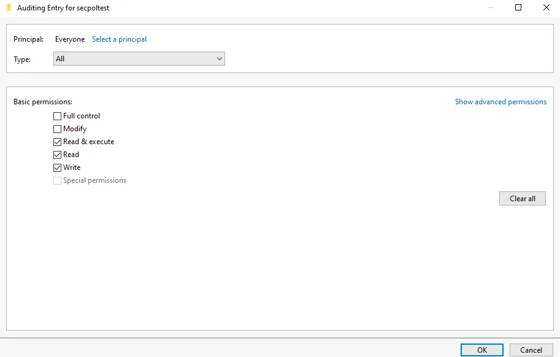
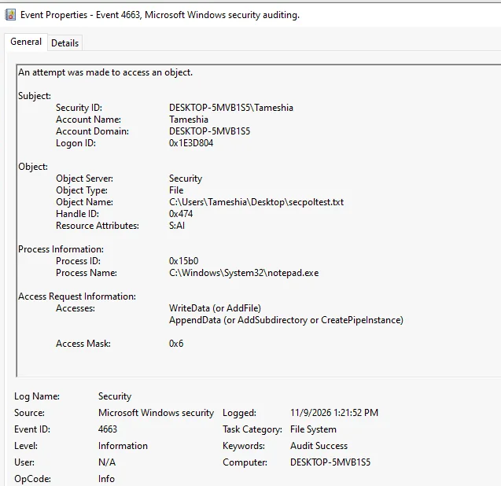
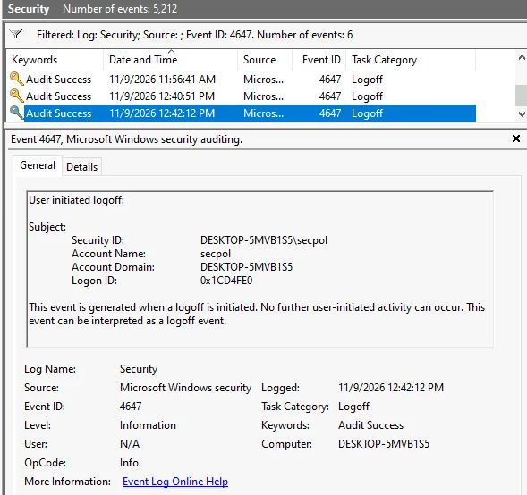
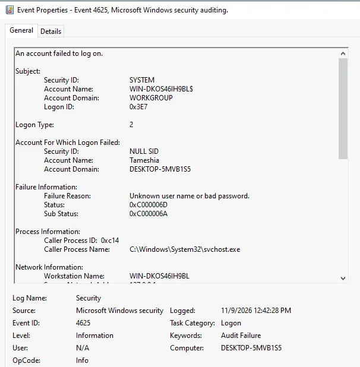
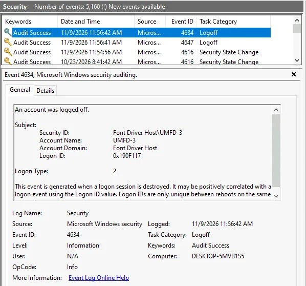

# Windows Local Security Policy: Configuration, Testing, and Security Auditing

## Project Overview

This lab explores how Windows local security settings affect account access, shutdown permissions, interactive sign-in messages, and security auditing. I configured the policies in a **Windows 10 training virtual machine**, tested their effects, and investigated the resulting events in **Event Viewer**.

This project documents a hands-on Windows security administration lab, including configuration, testing, Event Viewer evidence, troubleshooting, and lessons learned. Each section explains what was configured, why it matters, and how the result was verified.

> **Lab-only warning:** These settings restrict sign-in and shutdown rights and generate audit records. Use a disposable training VM, keep access to an administrator account, and do not apply these examples to a production or shared computer. Use unique, strong passwords for test accounts; never reuse lab credentials on real systems.

**Tools:** Computer Management (`compmgmt.msc`), Local Users and Groups (`lusrmgr.msc`), Local Security Policy (`secpol.msc`), File Properties, Event Viewer (`eventvwr.msc`)  
**Topics:** Local accounts, Users group, user rights, logon banners, advanced audit policy, file auditing, security events 4663 / 4647 / 4625

### Learning objectives

1. Create local standard-user accounts and check their group membership.
2. Restrict logon and shutdown rights using **User Rights Assignment**.
3. Configure a pre-logon warning using **Security Options**.
4. Enable advanced auditing for logoff, failed sign-in, and file-system access.
5. Configure a file-specific auditing entry and generate an auditable change.
6. Filter and interpret the Security log using Event IDs and event details.

## Part 1 — Creating User Accounts

### Step 1. Open Computer Management

1. Sign in to the Windows training VM with an administrator account.
2. Right-click **Start** and select **Computer Management**.
3. Expand **System Tools → Local Users and Groups → Users**.

**Why this matters:** Windows maintains local accounts separately from domain accounts. The Users node lets an administrator view or manage accounts on the current machine.

### Step 2. Create the practice accounts

1. Right-click **Users → New User**.
2. Create a practice account named `secpol`.
3. Create a second practice account named `secpol2`.
4. Use unique passwords for the test accounts; do not reuse them outside this lab.
5. Close the **New User** dialog.

**What to check:** Both accounts appear under **Local Users and Groups → Users**.

### Step 3. Inspect group membership

1. Double-click `secpol` or `secpol2`.
2. Select the **Member Of** tab.
3. Note the **Users** group membership.

**Why this matters:** Membership in **Users** provides the account with standard-user access. Membership is not the same as being an administrator and does not override explicit **Deny** user-rights assignments.

**📸 Screenshot 1:** The account's **Member Of** tab.

## Part 2 — Configuring a Local Security Policy

### Step 4. Open the Local Security Policy console

1. Open **Start**, search for **Local Security Policy**, and select it (or run `secpol.msc`).
2. Expand **Security Settings → Local Policies → User Rights Assignment**.

**Concept:** A user-rights assignment controls whether an account can perform a particular system action, such as signing in locally or shutting down the computer. These settings are different from permissions on individual files or folders.

### Step 5. Deny local sign-in to one test account

1. Double-click **Deny log on locally**.
2. Select **Add User or Group**.
3. Enter `secpol2`, then select **Check Names**.
4. Confirm that Windows resolves the name to the **local computer's account** and select **OK**.
5. Confirm `secpol2` is listed in the policy, then apply the change.

**Expected behavior:** The `secpol2` account cannot use an interactive local sign-in on that machine while the deny right applies.

**Why this matters:** An explicit **Deny** right takes precedence over a corresponding Allow right. This is useful to understand when investigating unexpected access failures.

### Step 6. Restrict shutdown rights

1. Still in **User Rights Assignment**, open **Shut down the system**.
2. Select the **Users** group and choose **Remove**.
3. Apply the change.

**Expected behavior:** A standard member of Users without another qualifying right should no longer have permission to shut down the computer locally. Accounts with other eligible group membership may behave differently.

**📸 Screenshot 2:** **Shut down the system** after removing **Users**.

**Study note:** Group membership grants some capabilities; a user-rights assignment determines which accounts and groups may perform a specific privileged action.

### Step 7. Create an interactive logon warning

1. Navigate to **Security Settings → Local Policies → Security Options**.
2. Open **Interactive logon: Message text for users attempting to log on**.
3. Enter the lab's message: `You are being monitored`.
4. Open **Interactive logon: Message title for users attempting to log on**.
5. Enter `WARNING` and apply it.

**Expected behavior:** The configured title and message appear before the sign-in process continues.

**📸 Screenshot 3:** Interactive logon message/title configuration. The image below documents the configured title; the matching message was `You are being monitored`.

**Why this matters:** Logon notices communicate usage expectations. A banner is not itself an access-control mechanism; the sign-in rights and authentication policies enforce access restrictions.

### Step 8. Enable advanced logon/logoff auditing

1. Expand **Security Settings → Advanced Audit Policy Configuration → System Audit Policies – Local Group Policy Object → Logon/Logoff**.
2. Open **Audit Logoff** and enable **Configure the following audit events → Success**.
3. Open **Audit Logon** and enable **Configure the following audit events → Failure**.
4. Apply each change.

**What to check:** The auditing policy now targets successful logoffs and failed logon attempts.

**Why this matters:** Auditing produces evidence that can help explain when and how a sign-in-related event occurred. The presence of a policy does not mean *every* expected event is guaranteed to appear in a particular filtered view.

### Step 9. Enable file-system auditing

1. In **Advanced Audit Policy Configuration**, expand **Object Access**.
2. Open **Audit File System**.
3. Select **Configure the following audit events**.
4. Enable **Success** and **Failure**, then apply the change.

**📸 Screenshot 4:** **Audit File System** with both Success and Failure selected.

**Important:** This setting enables the *category* of file-system auditing. To record access to a specific file, you also need an **auditing entry** for that file or folder (configured in Part 3).

## Part 3 — Testing the Security Policies

### Step 10. Verify the interactive logon warning

1. Sign out of the administrator session.
2. Observe the logon message displayed by Windows.
3. Confirm that the title is **WARNING** and the message is **You are being monitored**.

**📸 Screenshot 5:** Warning displayed before sign-in.

**What this tests:** The interactive logon message and title were applied to the training machine.

### Step 11. Test sign-in and shutdown rights

1. At account selection, inspect whether `secpol` is available and `secpol2` is blocked by the configured deny-local-logon policy.
2. Sign in with the permitted `secpol` standard account.
3. Attempt to shut down Windows through the Start menu.
4. Sign out and return to the administrator account.

**Expected result:** `secpol2` is prevented from local sign-in, while `secpol` can sign in but does not have the usual shutdown option after the Users shutdown right was removed.

**Troubleshooting concept:** Verify the effective behavior rather than assuming the policy worked solely because a dialog accepted the configuration.

### Step 12. Generate a failed sign-in event

1. At administrator sign-in, intentionally enter an incorrect password **once** in the training VM.
2. Dismiss the error and sign in using the correct password.
3. Later, inspect **Event ID 4625** for the failed attempt.

**Security note:** Avoid repeated failures on a production system because account-lockout rules may be enforced.

### Step 13. Create the file used for auditing

1. On the administrator's desktop, create a new text file named `secpoltest.txt` (Windows may hide the `.txt` extension).
2. Right-click the file → **Properties → Security → Advanced**.
3. Open the **Auditing** tab and select **Continue** if prompted for administrator authorization.

**Why this matters:** A file's auditing entries (its **System Access Control List**, or SACL) define whose access attempts should be logged and which types of file access matter.

### Step 14. Configure the file's auditing entry

1. From **Advanced Security Settings → Auditing**, select **Add**.
2. Choose **Select a principal**.
3. Enter **Everyone**, select **Check Names**, and confirm.
4. Set the auditing **Type** to **All**.
5. Under basic permissions, select **Read & execute**, **Read**, and **Write**.
6. Save the auditing entry and close the relevant dialogs.

**📸 Screenshot 6:** Auditing entry for `secpoltest.txt` showing principal, type, and selected access.

**Concept:** The principal **Everyone** is deliberately broad for this demonstration. In production, audit settings should be scoped to the required accounts and access types to limit unnecessary audit noise.

### Step 15. Generate file activity

1. Open `secpoltest.txt` in Notepad.
2. Type `test` and save the file.
3. Open **Event Viewer** by searching for it or running `eventvwr.msc`.
4. Navigate to **Windows Logs → Security**.

**What this tests:** The file access should generate an eligible security event if the audit policy and file-level auditing entry are both applied.

### Step 16. Find the file-access audit event

1. In **Windows Logs → Security**, select **Filter Current Log…**.
2. Enter Event ID `4663`.
3. Locate the event relating to `secpoltest.txt`.
4. Open its details and examine the account, object name, process name, access type, and time.

**📸 Screenshot 73:** Actual **4663** record showing file access.

**Observed in this completed lab:** The event related to `secpoltest.txt`, **Tameshia**, `notepad.exe`, **WriteData/AppendData**, access mask `0x6`, and time **1:21:52 PM**.

**Why this matters:** Event 4663 identifies an attempt to access an object. Details such as **Object Name**, **Process Name**, and **Accesses** help determine the activity instead of inferring it from the event ID alone.

### Step 17. Find the user-initiated logoff event

1. Use **Filter Current Log…** again.
2. Filter for Event ID `4647`.
3. Examine the **Subject** account and **Logon ID**.

**Observed in this completed lab:** A **4647** event showed user **secpol** initiating logoff at **11:56:41 AM** with Logon ID `0x1914C84`. A later repeated test at **12:42:12 PM** also showed `secpol` initiating logoff.

**Study point:** Event **4647** records a user-initiated logoff. It is useful for understanding an intentional end to an interactive session.

### Step 18. Find the failed sign-in event

1. In the Security log, filter for Event ID `4625`.
2. Open the event corresponding to the incorrect password from Step 12.
3. Review **Account Name**, **Logon Type**, **Status**, and **Sub Status**.

**Observed in this completed lab:** An **Audit Failure** at **12:42:28 PM** for **Tameshia**, **Logon Type 2** (interactive), status `0xC000006D`, substatus `0xC000006A` (incorrect password).

**Why this matters:** Event 4625 tells you authentication failed; the **substatus** explains the specific cause. A **Logon Type 2** record indicates an interactive sign-in attempt rather than a network sign-in.

### Step 19. Investigate a related logoff event

We also looked for **Event 4634** (*an account was logged off*) corresponding to the **4647** user-initiated logoff.

**Troubleshooting result:** A matching 4634 was **not found in the events reviewed**. Other nearby events involving `UMFD` or `DWM` were not treated as matches because their logon identifiers differed.

**Lesson:** Do not correlate Windows events using timestamps alone. Compare **Logon ID**, account, event type, and session context.

## Event ID Quick Reference

| Event ID | Description | What I reviewed |
| --- | --- | --- |
| **4663** | An attempt was made to access an object | File access, process name, WriteData/AppendData |
| **4647** | User initiated logoff | `secpol` account and Logon ID |
| **4625** | An account failed to log on | Incorrect password, Logon Type 2, status/substatus |
| **4634** | An account was logged off | Searched for a matching session; no match located |

## Screenshot Evidence

These screenshots document the Windows 10 lab configurations, policy tests, and security event investigations. Select any blue screenshot link to view the original image.

| Evidence | What it demonstrates | Screenshot |
| --- | --- | --- |
| **Account configuration** | Standard-user group membership | [Account membership](screenshots/01-local-user-membership.webp) |
| **Deny local logon** | `secpol2` added to the deny policy | [Deny logon policy](screenshots/03-deny-logon-after.webp) |
| **Shutdown permissions** | Users group removed from shutdown rights | [Shutdown right](screenshots/05-shutdown-after.webp) |
| **Shutdown test** | Standard account cannot access power options | [Restriction test](screenshots/11-shutdown-restriction-test.webp) |
| **Logon warning** | Interactive logon title configured | [WARNING title](screenshots/06-logon-title.webp) |
| **Warning test** | Logon notice displayed before sign-in | [Logon warning](screenshots/10-logon-warning-test.webp) |
| **Audit Logoff** | Success auditing enabled | [Logoff audit policy](screenshots/07-audit-logoff-success.webp) |
| **Audit Logon** | Failure auditing enabled | [Logon audit policy](screenshots/08-audit-logon-failure.webp) |
| **Audit File System** | Success and Failure auditing enabled | [File system policy](screenshots/09-audit-file-system.webp) |
| **File-specific auditing** | Auditing entry (SACL) on `secpoltest.txt` | [Auditing entry](screenshots/13-file-auditing-rule.webp) |
| **Event 4663** | Notepad writing to the audited file | [Notepad WriteData event](screenshots/15-notepad-write-4663.webp) |
| **Event 4663** | Background process reading the same file | [Background read event](screenshots/16-background-read-4663.webp) |
| **Event 4647** | `secpol` user-initiated logoff | [User logoff event](screenshots/12-logoff-4647.webp) |
| **Event 4634** | Nearby logoff event from a different session | [Session investigation](screenshots/18-unmatched-4634-umfd.webp) |
| **Event 4625** | Failed interactive sign-in and incorrect-password substatus | [Failed logon event](screenshots/17-failed-logon-4625.webp) |

### Investigation Notes

<strong>Account rights and policy validation</strong>

- `secpol` belonged to the standard **Users** group. Group membership and specific user-rights assignments serve different purposes.
- I added `secpol2` to **Deny log on locally**, restricting interactive local sign-in without disabling the account.
- I removed **Users** from **Shut down the system**. Signing in as `secpol` showed **“There are currently no power options available.”**
- The interactive logon title was `WARNING` and its message was `You are being monitored`. The banner appeared at sign-in; it communicates expectations rather than enforcing access control.

<strong>Auditing configuration and SACL</strong>

- Enabled **Audit Logoff — Success**, **Audit Logon — Failure**, and **Audit File System — Success and Failure**.
- On `secpoltest.txt`, configured an auditing entry for **Everyone**, type **All**, with **Read & execute**, **Read**, and **Write**.
- The system audit policy enables the category, while the file-specific **SACL** selects qualifying file access to record. A **DACL** determines access permissions.
- The broad Everyone auditing rule was used only in the disposable lab VM.

<strong>Event Viewer analysis: 4663, 4647, 4634, 4625</strong>

- **4663 — deliberate write:** `notepad.exe` accessed `secpoltest.txt` using **WriteData/AppendData**, access mask `0x6`.
- **4663 — background read:** A separate event showed background access to the same file. Comparing **Process Name**, **Object Name**, and **Accesses** distinguished the activities.
- **4647 — user-initiated logoff:** A `secpol` event provided a Logon ID to investigate.
- **4634 — logoff:** I did not confirm a matching `secpol` 4634 in the reviewed records. Nearby Windows component sessions must not be correlated using timestamps alone.
- **4625 — failed logon:** Logon Type `2`, status `0xC000006D`, and substatus `0xC000006A` indicated an incorrect password. Source `127.0.0.1` was loopback; a single failed sign-in is not proof of brute force.

**Takeaway:** I used account, process, access type, status, and session identifiers to interpret evidence rather than relying on event numbers alone.

## Review Questions

1. How is **Deny log on locally** different from assigning a user to the local **Users** group?
2. Why might removing **Users** from **Shut down the system** not affect every account?
3. Does setting **Audit File System** automatically log every access to every file? What other setting is needed?
4. What can Event **4663** reveal that an event ID alone cannot?
5. Which event ID records a **failed logon**, and which records a **user-initiated logoff**?
6. Why should a matching **Logon ID** be checked when correlating 4647 and 4634?
7. What does **Logon Type 2** indicate in Event 4625?

<strong>Review answers</strong>

1. Group membership defines which local group an account belongs to; a deny-user-rights assignment explicitly blocks a particular logon capability.
2. Another account may hold shutdown rights through a separate group or assignment.
3. No. An appropriate auditing entry (SACL) must also be configured for the file or folder.
4. The object affected, process involved, access requested, account, and timestamp.
5. **4625** is failed logon; **4647** is user-initiated logoff.
6. Nearby timestamps can represent different sessions or system accounts.
7. An interactive logon attempt at the computer.

## Lessons Learned

This lab followed a repeatable systems administration workflow:

**Create accounts → Configure policy → Test behavior → Generate audit events → Filter logs → Interpret evidence.**

I practiced distinguishing **group membership** from **user rights**, and **audit policy** from **file-specific auditing rules**. The Event Viewer investigation reinforced that an event's **account, Logon ID, process, and status details** are essential for interpreting what actually happened.

## Related Technical Write-Up

[Implementing and Validating Windows Local Security Policies](https://github.com/tameshia/technical-writeups/blob/main/windows-local-security-policy.md) summarizes the configuration, validation results, and limits of event correlation. This lab retains the full procedure and 15 screenshot files.

---

[← Back to IT Systems Administration Labs](../README.md)

*All screenshots and event observations are from my Windows 10 lab environment. Security settings were tested on a dedicated virtual machine, not a production system.*
