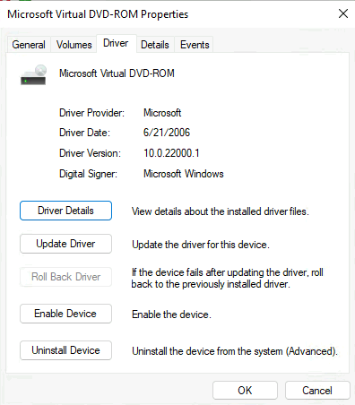
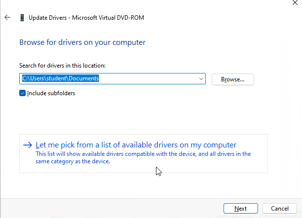
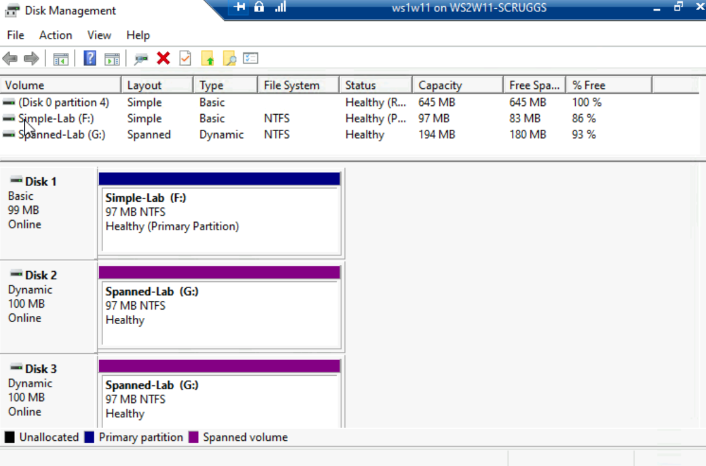
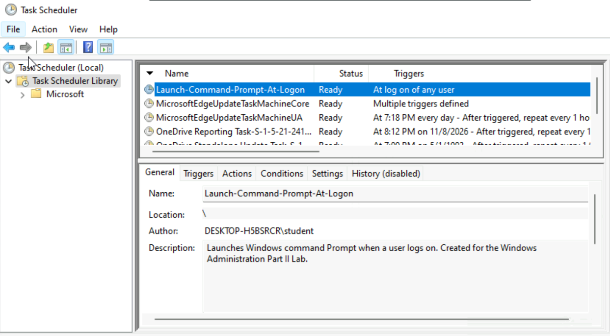
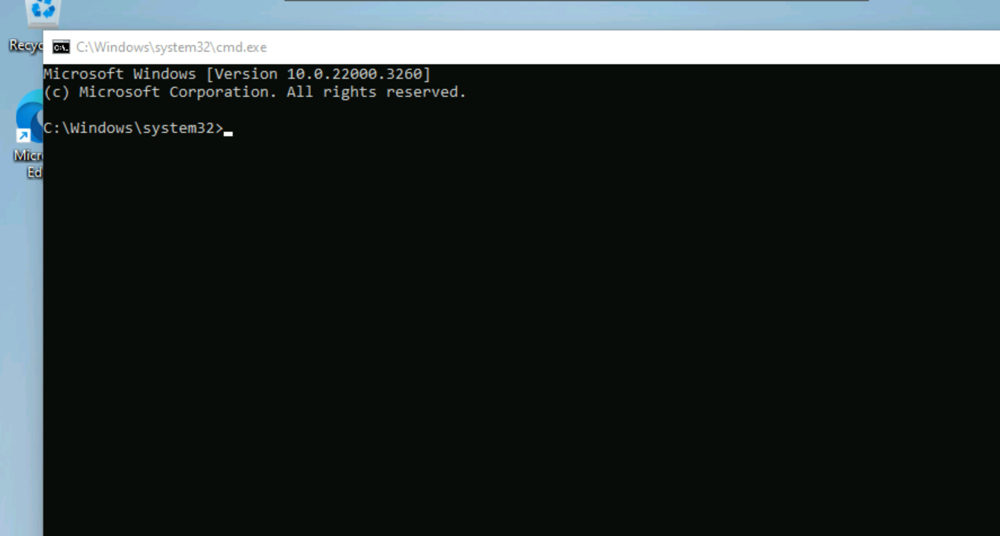
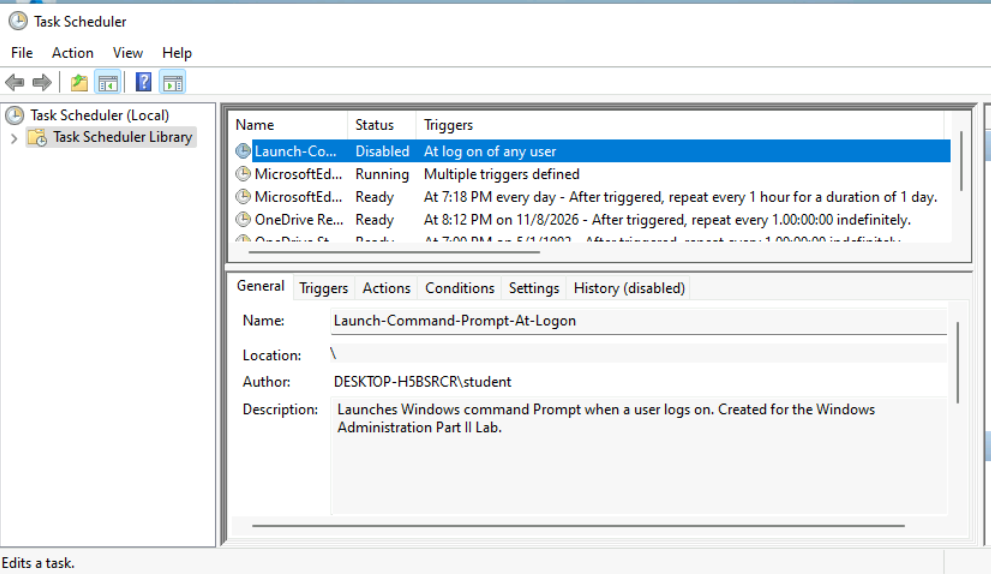
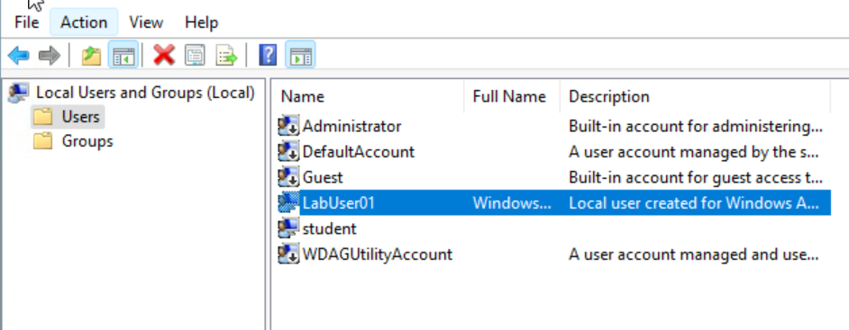
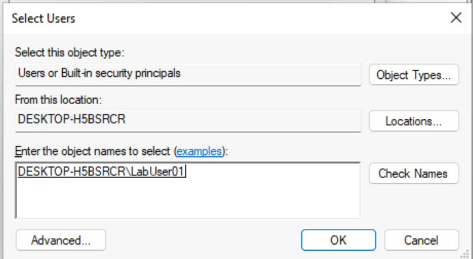
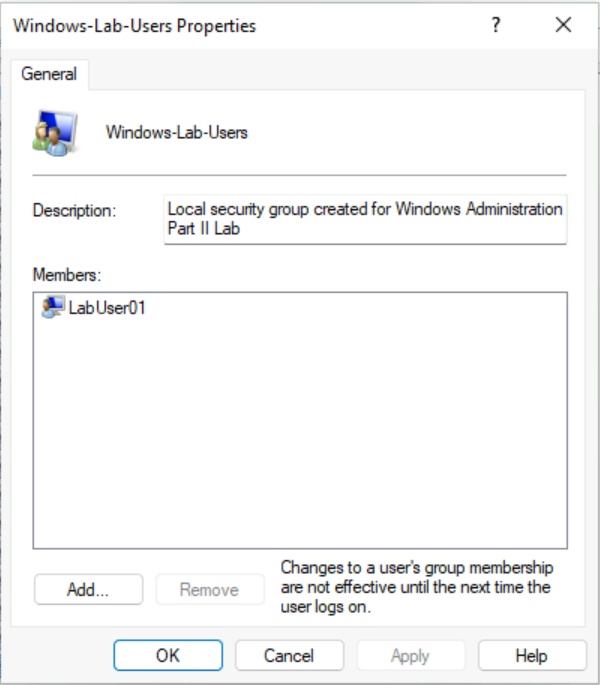

# Windows Management Part II: Devices, Storage, Automation, and Local Accounts

## Project Overview

In this lab, I used four Windows administrative consoles to manage a virtual DVD-ROM device, configure simple and spanned storage, automate a program at logon, and create a local user and security group. I validated the resulting configuration and disabled the scheduled task after testing.

**Environment:** School-provided Windows 11 VM, **ws1w11**, in a Hyper-V training environment  
**Tools:** Device Manager, Disk Management, Task Scheduler, Local Users and Groups  
**Topics:** Device state, driver selection, MBR, NTFS, dynamic disks, logon triggers, least privilege, group membership

### Learning objectives

1. Distinguish disabling hardware from removing its driver.
2. Create and validate NTFS simple and spanned volumes.
3. Separate a task's trigger, action, execution identity, and conditions.
4. Create a local identity and verify its security-group membership.
5. Document observed results separately from explanatory concepts.

### Evidence and scope

This write-up draws on the completed **Managing Windows – Part II** assignment and the accompanying lab conversation. **Nine screenshot files** are organized by section: six embedded assignment images and three supplemental images. Repeated copies of the same result are omitted. The original assignment document is not republished here.

Screenshots establish the visible states described below. Actions discussed during the lab without a separate final-state screenshot are identified accordingly. Reference explanations, troubleshooting suggestions, and hypothetical access-control examples are not additional tests performed in the VM.

| Section | Verified outcome | Evidence limit |
| --- | --- | --- |
| Device Manager | Virtual DVD-ROM disabled; manual driver-browse wizard opened | No completed driver installation; no separate re-enabled-state screenshot |
| Disk Management | F: simple volume, 97 MB NTFS; G: spanned volume, 194 MB NTFS; Disks 2–3 dynamic | Final state captured, not every wizard page |
| Task Scheduler | Task registered, Command Prompt observed after logon, task disabled | No exported task XML or task-history execution trace |
| Local Users and Groups | LabUser01 created and listed in Windows-Lab-Users properties | No resource-permission assignment or access test |

> **Lab scope:** Disk initialization, formatting, and conversion were performed on disposable training disks. Verify disk identity and protect existing data before storage changes. Disk numbers and drive letters here are observations from this VM, not universal instructions.

## Part 1 — Device Manager

I opened Device Manager using `devmgmt.msc`, expanded **DVD/CD-ROM drives**, and examined **Microsoft Virtual DVD-ROM** properties.

### Disable and re-enable a device

On the Driver tab, I selected **Disable Device**. The captured Driver tab then displayed **Enable Device**, confirming that the device had been disabled.



The lab discussion covered **Code 22**, which indicates an administratively disabled device. The retained screenshot shows the Driver tab rather than a General-tab Code 22 message, so it is not presented as a screenshot of that code.

Re-enabling the device was part of the lab workflow before exploring driver updates; there is no separate retained screenshot proving the final enabled state. Disabling a device prevents its normal use through Windows; it does not physically disconnect the device or uninstall the driver.

### Explore manual driver selection

I selected **Update driver → Browse my computer for drivers**. The screenshot shows `C:\Users\student\Documents` as the search location and **Include subfolders** checked. I canceled the wizard as instructed; **no replacement driver installation or driver-version change is claimed**.



**Concept:** A driver lets Windows communicate with a device. A downloaded driver package commonly includes an INF file describing installation information. Opening this wizard demonstrates the manual-search workflow, not successful installation or proof that a newer driver exists.

## Part 2 — Disk Management

I opened `diskmgmt.msc`. The assignment specified initializing the experimental disks with **MBR**, creating a whole-disk NTFS simple volume on Disk 1, and spanning Disks 2 and 3. MBR initialization is documented in the workflow; the retained final view does not independently display partition-style properties.

### Actual resulting storage

| Object | Visible result |
| --- | --- |
| Disk 1 | Basic, Online, displayed disk size **99 MB** |
| Simple-Lab (F:) | Simple / Basic, **97 MB**, NTFS, Healthy (Primary Partition) |
| F: free space | **83 MB**, 86% displayed |
| Disk 2 | Dynamic, Online, displayed disk size **100 MB**; **97 MB** G: extent |
| Disk 3 | Dynamic, Online, displayed disk size **100 MB**; **97 MB** G: extent |
| Spanned-Lab (G:) | Spanned / Dynamic, **194 MB**, NTFS, Healthy |
| G: free space | **180 MB**, 93% displayed |



The assignment describes four nominal 100 MB experimental disks and a 64 GB Windows disk. Those are assignment specifications, not all independently visible measurements in this cropped final view. In particular, Disk 1 actually displays **99 MB**, and its volume displays **97 MB**. Disk-level capacity, usable allocation, file-system metadata, and display rounding can differ; the screenshot does not establish an exact byte-by-byte accounting.

### Dynamic disk conversion

Creating the spanned volume involved converting **Disks 2 and 3 from basic to dynamic**. Their final **Dynamic** labels and G:'s **Spanned / Dynamic** listing confirm the resulting state. Disk 1 remained basic. There is no retained conversion-dialog screenshot or claim that every disk was converted.

The two 97 MB extents form **one 194 MB G: volume**. They are not two independent G: drives. Dynamic disk management and MBR/GPT partition style describe different aspects of storage; conversion to dynamic is not the same operation as converting MBR to GPT.

### Capacity is not redundancy

A spanned volume combines capacity across disks. It does **not** mirror data or provide fault tolerance. Losing a member disk can make the volume unusable and cause data loss. No disk-failure simulation, recovery, mirror, striped volume, or RAID-5 configuration was performed.

The assignment loosely describes spanning as software RAID. More precisely, this was a **dynamic spanned volume without RAID redundancy**. Microsoft's current guidance deprecates dynamic disks for most uses and recommends alternatives for new deployments; this lab documents the assigned legacy feature rather than recommending it for a new system.

**Related concepts, not additional lab operations:** NTFS supports Windows file permissions and journaling. FAT32 lacks NTFS-style file ACLs and has a single-file limit just under 4 GiB. GPT can be used for data disks without requiring UEFI boot; booting Windows from GPT has separate firmware requirements. These distinctions clarify simplified statements in the assignment.

## Part 3 — Task Scheduler

I opened `taskschd.msc` and used **Create Task**.

| Configuration | Lab value |
| --- | --- |
| Name | `Launch-Command-Prompt-At-Logon` |
| Execution account | `DESKTOP-H5BSRCR\student` |
| Security option | Run only when user is logged on |
| Highest privileges | Unchecked |
| Trigger | At log on of any user; enabled |
| Action | Start a program: `cmd.exe` |
| Arguments / Start in | Left blank |
| Conditions | AC-power requirement cleared; no idle, wake, or network requirement selected |

These configuration details were reviewed during the conversation; the retained listing is not a screenshot of every tab. The dependent **Stop if the computer switches to battery power** option appeared gray with a checkmark after the AC-power requirement was cleared; I do not describe both boxes as visibly unchecked.

### Register, test, and clean up

1. Saved the task and confirmed **Ready** in Task Scheduler Library.
2. Signed out and back into the student account. Command Prompt appeared without manually launching it during that test.
3. Returned to Task Scheduler and disabled the task. Its final status was **Disabled**.





Visible console excerpt:

```text
Microsoft Windows [Version 10.0.22000.3260]
C:\Windows\system32>
```

The observation after logon supports successful execution. The console image alone cannot identify its launching process; no task-history event, execution return code, or process-parent trace is claimed. **Ready** by itself establishes readiness, not prior successful execution.



Disabling retains the saved definition while preventing automatic runs. Deleting the task was not part of the cleanup. No second logon test after disabling is documented.

**Security takeaway:** The trigger determines when to run; the configured principal determines whose security context runs the action. **Any user** does not automatically change the principal to whoever signs in. An interactive task is appropriate for a visible Command Prompt window. A background maintenance task might instead use **Run whether user is logged on or not**, with appropriate credentials and permissions; that scenario was discussed, not configured here.

## Part 4 — Local Users and Groups

I opened `lusrmgr.msc`, reviewed existing local accounts, and created **LabUser01** with full name **Windows Lab User**. In the reviewed creation dialog, **User must change password at next logon** was cleared as required by the assignment. The other account-option checkboxes were also unchecked. No password is included in this repository.



I created **Windows-Lab-Users**, selected **Add**, entered `LabUser01`, and used **Check Names**. Windows resolved the identity to `DESKTOP-H5BSRCR\LabUser01`.



After saving the group, I opened its properties and verified **LabUser01** under Members.



This verifies membership in the custom local group. It does not establish all of the account's memberships, prove its effective privileges, or show an NTFS permission assignment. No sign-in or folder-access test using LabUser01 was performed in this section.

### Why groups are useful

Groups let administrators assign resource access to a role and then manage membership as people join or leave. This reduces repetitive permission changes and supports consistent access control. A new custom group does not automatically grant access to a folder or administrative privileges.

**Explanatory example:** If Windows-Lab-Users receives Read permission on a folder, that membership alone does not authorize modification. Effective access also depends on other applicable permissions, inheritance, and deny entries. No such folder ACL was configured in this lab.

**Access tokens:** Windows creates an access token at logon containing identity, groups, and privileges. Changing group membership generally does not rewrite tokens already in use. Signing out and back in obtains a new token; immediate revocation may also require ending relevant sessions or connections. This explains the membership notice in Group Properties; removal during an active session was not tested.

## Troubleshooting and Security Lessons

The table below is a troubleshooting guide derived from the lab, not a record of additional failures encountered.

| Symptom or question | First check and rationale |
| --- | --- |
| Device unavailable after disabling | Inspect device status; enable the intended device before assuming hardware failure |
| Driver wizard opens but nothing changes | Browsing is not installation; verify a suitable package and an actual completion result |
| Unexpected disk count or capacity | Confirm the assigned VM and disk roles before changing storage; distinguish disk size from volume capacity |
| Spanned volume prompts for conversion | Verify the selected disposable disks; dynamic conversion changes storage management and compatibility |
| Task is Ready but no window appears | Check trigger, execution account, interactive setting, action, and Conditions; readiness is not execution evidence |
| Task blocked on battery | Inspect Power conditions; also consider sleep state and whether waking is configured |
| Account cannot be resolved | Check spelling and the selected computer or directory using Check Names |
| Membership changed but access persists | Consider existing tokens and connections; inspect effective access before claiming revocation |

Key practices reinforced here were validating results after configuration, using descriptive object names, avoiding unnecessary elevation, separating identity from authorization, and disabling temporary automation after testing. Adding every user to Administrators would undermine least privilege and increase the impact of mistakes or compromised accounts.

## Screenshot Evidence Index

| Section | Files |
| --- | --- |
| Device Manager | [Disabled device](screenshots/device-manager/01-device-disabled.png) · [Driver-browse wizard](screenshots/device-manager/02-browse-drivers.png) |
| Disk Management | [Final volume layout](screenshots/disk-management/01-final-volumes.png) |
| Task Scheduler | [Ready](screenshots/task-scheduler/01-task-ready.png) · [Post-logon console](screenshots/task-scheduler/02-command-prompt-after-logon.png) · [Disabled](screenshots/task-scheduler/03-task-disabled.png) |
| Local Users and Groups | [User created](screenshots/local-users-groups/01-user-created.png) · [Name resolved](screenshots/local-users-groups/02-name-resolved.png) · [Membership verified](screenshots/local-users-groups/03-membership-verified.png) |

## References

Official documentation explains the underlying behavior; my screenshots and recorded observations establish the lab results.

- [Microsoft Support — Device Manager error codes, including Code 22](https://support.microsoft.com/en-us/topic/error-codes-in-device-manager-in-windows-524e9e89-4dee-8883-0afa-6bca0456324e)
- [Microsoft Learn — Basic and dynamic disks](https://learn.microsoft.com/en-us/windows/win32/fileio/basic-and-dynamic-disks)
- [Microsoft Learn — Convert a disk to dynamic or basic](https://learn.microsoft.com/en-us/windows-server/storage/disk-management/change-disk-type-dynamic-basic)
- [Microsoft Learn — Starting an executable when a user logs on](https://learn.microsoft.com/en-us/windows/win32/taskschd/starting-an-executable-when-a-user-logs-on)
- [Microsoft Learn — Security contexts for tasks](https://learn.microsoft.com/en-us/windows/win32/taskschd/security-contexts-for-running-tasks)
- [Microsoft Learn — Access tokens](https://learn.microsoft.com/en-us/windows/win32/secauthz/access-tokens)

---

[← Back to IT Systems Administration Labs](../README.md)
