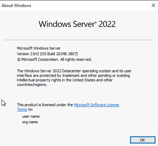
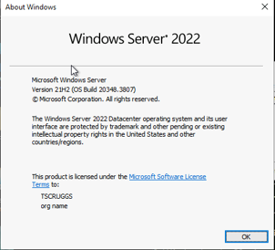
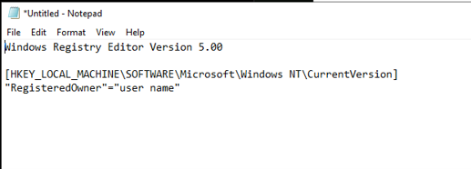

# Windows Registry Editor: Backup, Modification, and Restoration

## Project Overview

In this Windows Server 2022 lab, I used the Windows Registry Editor to inspect and change the `RegisteredOwner` value, verified the change with `winver.exe`, and practiced backing up and restoring a Registry key. I also examined the structure of a Windows Registry export (`.reg`) in Notepad.

The exercise demonstrates how a small Registry change can affect information displayed by Windows and why creating a backup before editing configuration settings is an important precaution.

## Lab Environment and Tools

- **Operating system:** Windows Server 2022 Datacenter, version 21H2 (virtual machine)
- **Tools:** Command Prompt, Registry Editor (`regedit.exe`), About Windows (`winver.exe`), Notepad
- **Registry key:** `HKEY_LOCAL_MACHINE\SOFTWARE\Microsoft\Windows NT\CurrentVersion`
- **Value examined:** `RegisteredOwner`

## Objectives

1. View the currently registered owner using `winver.exe`.
2. Export the `CurrentVersion` Registry key before making changes.
3. Modify `RegisteredOwner` and verify the result.
4. Import the saved Registry backup to restore the original value.
5. Inspect the key path and value inside a `.reg` file.

## Procedure and Observations

### 1. Inspect the Original Registered Owner

I opened an elevated Command Prompt and ran:

```cmd
winver.exe
```

The About Windows dialog displayed the Windows Server 2022 version and the original registered-owner information.



*Before the change: `winver.exe` displays the original registered-owner information.*

### 2. Export the Registry Key

I opened Registry Editor with:

```cmd
regedit.exe
```

Then I navigated to:

```text
HKEY_LOCAL_MACHINE\SOFTWARE\Microsoft\Windows NT\CurrentVersion
```

Before changing anything, I right-clicked the `CurrentVersion` key, selected **Export**, and saved the Registry backup to the desktop.

**Why the backup matters:** An exported Registry key preserves its existing values, providing a way to restore prior settings if a change causes a problem. Importing a backup should still be done carefully, since some values may be in use or may not merge successfully.

### 3. Modify and Verify `RegisteredOwner`

In the `CurrentVersion` key, I located the `RegisteredOwner` value and changed its data. I ran `winver.exe` again and confirmed that the About Windows dialog displayed the modified registered owner.



*After the change: the About Windows dialog displays the updated `RegisteredOwner` value.*

**Observation:** The `RegisteredOwner` Registry value controls the registered-owner text shown in this dialog. Changing it did not change a Windows user account or grant different permissions.

### 4. Restore the Original Value

I imported the `.reg` backup created before the change and checked the `RegisteredOwner` value to verify that the original setting was restored.

This step reinforced why exporting relevant Registry settings before modifying them can make troubleshooting and rollback easier.

### 5. Examine the Registry Export

I opened the exported `.reg` file in Notepad and located three important elements:

1. The Registry file header: `Windows Registry Editor Version 5.00`
2. The key path in square brackets: `[HKEY_LOCAL_MACHINE\SOFTWARE\Microsoft\Windows NT\CurrentVersion]`
3. The `RegisteredOwner` name and its associated value

I copied these three lines into a separate Notepad document to study how the export represented the setting.

```reg
Windows Registry Editor Version 5.00

[HKEY_LOCAL_MACHINE\SOFTWARE\Microsoft\Windows NT\CurrentVersion]
"RegisteredOwner"="user name"
```

*The value above is the illustrative text shown in my lab screenshot, not the actual owner information from the exported backup.*



*The Notepad excerpt shows the Registry file version, the `CurrentVersion` key path, and a `RegisteredOwner` value.*

## Skills Demonstrated

- Navigating Registry hives, keys, and values
- Identifying a Windows configuration setting
- Backing up a Registry key before modification
- Editing and validating a `REG_SZ`-style value
- Restoring settings from a Registry export
- Reading basic `.reg` file syntax
- Documenting changes and verifying their effects

## Lessons Learned

The Windows Registry stores configuration values used by Windows and applications. Editing those settings requires care because incorrect changes can affect system behavior. In this lab, I practiced an orderly workflow: **inspect → back up → modify → verify → restore**. I also learned that a Registry export is a readable text-based representation of keys and values, not just an opaque backup file.

---

[← Back to IT Systems Administration Labs](../README.md)

*This project documents a completed IT120 A+ Core 2 coursework lab using Windows Server 2022. The write-up is organized as a technical portfolio case study.*
